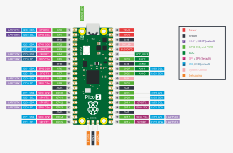
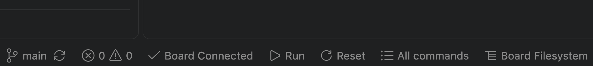

# CMPSC 100 Final Project

|Item |       |
|:----|:------|
|Released |Monday, November 16, in class |
|Pitch |Monday, November 23, in class |
|Due |Friday, December 4, 2:30pm, with the code review at the lab session |
|Demo fair |Monday, December 7, 9:00am (Exam Code A) |
|Progress |[](../../actions/workflows/main.yml) |

For the final project, you design and build a program of your own on the Pico 2 W. It can be a
game, a tool, an alarm, an instrument, a monitor, or anything else you would like to make, as long
as it reads at least one input, drives at least one output, and is built from classes.

You can work on your own or in a team of two or three.

## Contents

* [Course learning outcomes](#course-learning-outcomes)
* [Timeline](#timeline)
* [Requirements](#requirements)
  * [Working on your own or as a team](#working-on-your-own-or-as-a-team)
* [Hardware](#hardware)
  * [The light sensor](#the-light-sensor)
  * [The buzzer](#the-buzzer)
* [The design document](#the-design-document)
* [Getting started](#getting-started)
* [The pitch](#the-pitch)
* [Code review](#code-review)
* [The demo fair](#the-demo-fair)
* [Evaluation](#evaluation)
* [Using AI](#using-ai)
* [Submitting](#submitting)

## Course learning outcomes

This project addresses the following course learning outcomes:

**CLO 1.** Apply Python programming fundamentals to execute and explain computer code that
implements interactive, novel solutions to a variety of computable problems.

**CLO 2.** Implement code consistent with industry-standard practices using professional-grade
integrated development environments (IDEs), command-line tools, and version control systems.

**CLO 4.** Evaluate the practical and ethical implications of writing computer code and discuss the
contexts, perceived effects, and impacts exerted on and by computer code as a cultural force or
artifact.

**CLO 5.** Design, describe, and implement original projects incorporating industry-standard
practices and Python language fundamentals.

## Timeline

|Date |What happens |
|:----|:------------|
|Monday, November 16 |The project is released. Please start thinking about ideas, and form a team if you would like one |
|Monday, November 23 |Pitch your idea at your table. Before class, please write the first two sections of `docs/design.md` |
|November 23 to December 4 |Build the project on branches, merging each part through a pull request |
|Friday, December 4, 2:30pm |The project is due on `main`. Your code review, with a whiteboard, happens at the lab session |
|Monday, December 7, 9:00am |Demo fair |

## Requirements

Your project needs to:

* run on the Pico 2 W from `src/main.py`, which makes the objects and connects them
* read at least one input (a button, the light sensor, or the temperature sensor in the Pico's chip)
  and drive at least one output (an LED or the buzzer)
* keep each class in its own file in `src`, with `__init__` and at least two more methods in each
  class, and at least two methods across the project that return a value
* use at least one list, one dictionary, one loop and one `if` statement
* have a docstring for each class and function, and at least two comments in each file
* be built on branches and merged through at least two pull requests, with Merge pull request
* have a complete `docs/design.md`

The program can use what we have covered in class and anything else you learn along the way,
provided you can explain it at the code review.

### Working on your own or as a team

|Requirement |On your own |Team of two or three |
|:-----------|:-----------|:--------------------|
|Class files |At least two |At least one for each person, and each person writes their own |
|Hardware |At least one input and one output |At least one input and one output |
|Pull requests |At least two, merged by you |Each person merges their own, after a teammate approves it |
|Pitch and demo fair |One pitch and one demo station |One pitch and one demo station for the team, where each person speaks |
|Code review |One review |One review for each person, about the files they wrote |

Please list your team, and who owns which file, in `docs/design.md` by the pitch. A team accepts
the project once, as a team, through Classroom50.

## Hardware

You can use each part from your kit: the LEDs with their resistors, the push button, and the
temperature sensor in the Pico's chip, as in Labs 5 through 8. A light sensor and a buzzer are also
available. Please ask Dr. Jumadinova for the ones you need by the pitch on November 23. Remember
to unplug the USB cable before you change the wiring.



### The light sensor

The light sensor is a photoresistor, which lets more current through in brighter light. It needs a
10k ohm resistor beside it:

* one leg of the photoresistor to **3V3(OUT)** (physical pin 36)
* the other leg of the photoresistor to **GP26** (physical pin 31)
* the 10k ohm resistor from **GP26** to **GND**

With this wiring, the reading goes up as the room gets brighter. GP26, GP27 and GP28 can each
read a light sensor.

```python
from machine import ADC

light = ADC(26)
reading = light.read_u16()  # 0 in the dark, up to 65535 in bright light
```

### The buzzer

The buzzer has two legs, and the longer one, marked `+`, goes to a GP pin. The shorter one goes to
**GND**. It sounds when its pin is switched on and off quickly, which `PWM` does for you. `freq` sets
the pitch in hertz, and `duty_u16` sets it sounding (`32768`) or quiet (`0`).

```python
from machine import PWM, Pin
from time import sleep

buzzer = PWM(Pin(18))
buzzer.freq(440)        # the note A
buzzer.duty_u16(32768)  # on
sleep(0.5)
buzzer.duty_u16(0)      # off
```

## The design document

`docs/design.md` describes your project: the idea, the team, the hardware with its pins, a diagram
of how your classes connect, the feedback from your pitch, and how you used AI. Please write the
first two sections before the pitch, and keep the rest up to date as the project changes. At the
code review, you will draw your class diagram on the whiteboard.

## Getting started

1. **Write your idea and team** in `docs/design.md`.
2. **Plan your classes.** Each thing in your project, such as a sensor, a light, a game or a log,
   can be a class. What it remembers becomes its attributes, and what it does becomes its methods.
   Please see [Methods, Abstraction, Encapsulation, slide 13](https://computationalexpression.com/slides/week-12-session-3/#13).
3. **Get one part working first.** Wire one input and one output, and test them with a short
   program on the board before you write the classes.
4. **Build one class at a time**, each on its own branch, and merge it through a pull request.

You can check your work as you go by running this from the project's top-level folder:

```text
uv run gatorgrade --config gatorgrade.yml
```

To run the project on the board, upload each class file first: right-click it in the Explorer,
choose MicroPico, then **Upload File to Board**. Then open `src/main.py` and click **Run** in the bar
along the bottom of the window, with **Board Connected** showing beside it:



## The pitch

On Monday, November 23, you will pitch your idea to the other students at your table, in two or
three minutes: what the project does, who would use it, the hardware, and the classes you plan.
Your classmates will give you written feedback, and you will give feedback on theirs. Please write
two pieces of feedback you received, and what you changed because of them, in `docs/design.md`.

## Code review

Your code review is at the lab session on Friday, December 4, with a Technical Leader or the
instructor. You will run your project on the board, draw your class diagram on the whiteboard, and
answer questions about your own code. In a team, each person has their own review, about the files
they wrote. The reviewer opens a **Code Review** issue on your repository. The questions differ
from student to student, so please be ready to:

* **Classes and objects**: explain what each of your classes remembers and does, and how `main.py`
  connects them
* **Methods and self**: trace one of your methods on the whiteboard, with the value of each
  attribute before and after
* **Data**: explain what your list and dictionary hold, and trace a loop over one of them
* **Decisions**: explain one of your `if` statements, and what happens at its edge, such as a
  reading exactly at a dividing value
* **Hardware**: explain how your code reads its input and drives its output, and which pins they use

If you cannot attend that lab, please arrange your review beforehand at office hours.

## The demo fair

The demo fair is during the final exam slot, on Monday, December 7, at 9:00am. Half of the class
sets up their projects at stations while the other half visits, and the two halves swap at the
midpoint. When it is your turn at a station, you will show your project running and explain in two
or three minutes what it does and how it works, to each small group that visits. When it is your
turn to visit, you will fill in a feedback sheet for each project you see.

## Evaluation

The project is worth **18 points**.

| Component | Points | What it measures |
|:----------|:-------|:-----------------|
| Pitch | 2 | Your idea and team written in `docs/design.md` before the pitch (1), your pitch and the feedback you gave classmates (1) |
| Program | 8 | The 15 checks below, as a fraction of 4 points; code quality in the files you wrote: descriptive names, clear organization and useful comments (2); a complete `docs/design.md` that matches the code (2) |
| Code review | 5 | One point for each of the five topics above, answered with your own code on the whiteboard |
| Demo fair | 3 | The project running at your station (1), your explanation of how it works (1), and your feedback sheets for classmates' projects (1) |
| **Total** | **18** | |

In a team, the checks and the design document are shared, and the code quality score, the code
review and the feedback sheets are your own.

You can run the checks yourself, as many times as you like:

```text
uv run gatorgrade --config gatorgrade.yml
```

Each check's description says what to look at when it fails. Under a failed check, gatorgrade
also prints a `uv run pytest ...` command, and when you run it, the last lines tell you what was
found and what was expected. Here are the fifteen checks:

* `src/main.py` has a docstring and a `main()` function, and imports from at least two class files
* at least two files in `src` besides `main.py` each define a class
* each class has `__init__` and at least two more methods
* at least two methods return a value
* each class and function has a docstring
* the project reads an input with `Pin.IN` or `ADC`
* the project drives an output with `Pin.OUT` or `PWM`
* the code uses a list and a dictionary
* the code uses a loop and an `if` statement
* each class file imports without an error on a pretend board
* no `TODO` markers remain in `src`
* each file in `src` has at least two comments
* at least two pull requests are merged with Merge pull request
* no `TODO` markers remain in `docs/design.md`
* `docs/design.md` has at least 300 words

> [!NOTE]
> Automated results are preliminary. Your instructor sets the final grade.

## Using AI

You are welcome to use AI tools such as GitHub Copilot on this project, with two expectations.
Please make sure you understand each line you submit, since the code review asks you to trace and
explain your own code on the whiteboard. Please also describe in `docs/design.md` which tools you
used, what you asked them, and which parts of your code they helped with.

## Submitting

The `main` branch on GitHub at 2:30pm on Friday, December 4, is what gets graded, so please merge
your pull requests before then. Late tokens cannot be used on the final project.
